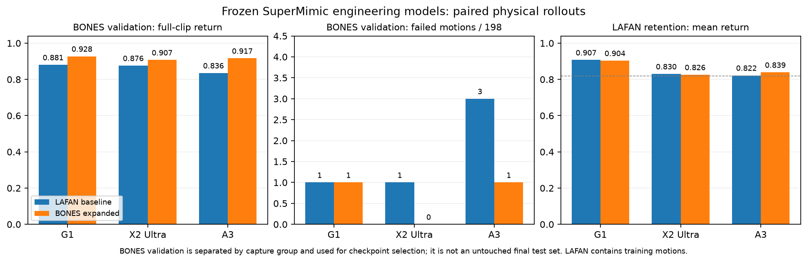

# supermimic-retargeted

Personal, AI-assisted robot adaptation of **SuperMimic-Reproduced** for **G1, A3 and X2 Ultra**.

本仓库主要通过 vibe coding，把社区已有的 SuperMimic 复现接入 A3、X2 Ultra，并整理了数据处理、训练、评测和参考虚影渲染流程。我们没有提出新的算法，也不是机器人厂商或 SuperMimic 作者的官方项目。

训练实现主要来自 [CuboiLeo/SuperMimic-Reproduced](https://github.com/CuboiLeo/SuperMimic-Reproduced)，交叉参考 [zita-ch/supermimic_vibed](https://github.com/zita-ch/supermimic_vibed)。请优先引用原论文和上游项目。固定版本与其他来源见 [UPSTREAM.md](UPSTREAM.md)。

## 支持范围

| 本体 | 关节数 | 本次验证 |
|---|---:|---|
| Unitree G1 | 29 | LAFAN1、BONES 子集 |
| A3 | 31 | LAFAN1、约一万条 BONES 动作 |
| X2 Ultra | 31 | LAFAN1、约两千条 BONES 动作 |

A3/X2 的适配包括关节与状态维度、可微 FK、机器人参数、SOMA 重定向、LAFAN 骨骼坐标系及骨盆支点修正，以及脚底接触质检。`scripts/render_policy.py` 在同一个场景中显示实体策略与半透明参考虚影；虚影不参与物理碰撞，也不进行逐帧位置对齐。

## 安装

需要 Linux、Python 3.12、uv 和适配 CUDA 13 的 NVIDIA 驱动；渲染视频另需 `ffmpeg`。本次训练使用 RTX 6000D，每个本体两张卡。依赖锁定在 `uv.lock`，SOMA 使用独立环境。

```bash
uv sync --frozen --group dev
uv run python scripts/fetch_upstreams.py
uv sync --project vendor/soma-retargeter --frozen
uv run python scripts/build_robot_assets.py
```

`fetch_upstreams.py` 获取固定 commit 的 SOMA 和机器人参考仓库，跳过大型 LFS 权重。机器人 URDF、网格和第三方模型不随本仓库再分发；生成的 `assets/robots/` 也不提交 Git。若上游网格是 LFS 指针，需要从对应上游获取实际网格文件。

如果系统的 `PYTHONPATH` 带有 ROS 等其他环境的包，请先 `unset PYTHONPATH`。

## 数据准备

代码仓库不包含动作数据、模型权重、日志或虚拟环境。动作来源、完整处理步骤及 BONES 镜像下载见 [docs/DATA.md](docs/DATA.md)。40 条 LAFAN 清单和 BONES 的 2k/10k/验证选择清单在 `manifests/`。

将已处理的 50 Hz NPZ 放在 `data/npz/<robot>/lafan1/`，其中 `<robot>` 为 `g1`、`a3` 或 `x2_ultra`。原始 CSV 输入帧率：本次 LAFAN 为 30 Hz，BONES 为 120 Hz。请按实际源文件填写，不能混用。

## 训练

所有命令从仓库根目录运行。`scripts/robot.py` 在导入模块前选择本体，默认读取本地生成的机器人 profile。

```bash
# 单卡 LAFAN；将 a3 替换为 g1 或 x2_ultra
uv run python scripts/robot.py a3 -m supermimic.scripts.train \
  --run-name a3_lafan --data.npz-dir data/npz/a3/lafan1 \
  --env.num-envs 4096 --env.replay-capacity 512 --env.anchor-obs \
  --policy-trainer.batch-size 2048 --schedule.max-hours 3

# 两卡数据并行
uv run python scripts/robot.py a3 -m torch.distributed.run \
  --standalone --nproc-per-node 2 -m supermimic.scripts.train \
  --run-name a3_lafan_ddp --data.npz-dir data/npz/a3/lafan1 \
  --env.num-envs 4096 --env.replay-capacity 512 --env.anchor-obs \
  --policy-trainer.batch-size 2048 --schedule.max-hours 3
```

从 LAFAN 扩大到 BONES 时，用 `scripts/data/build_library.py` 打包经过过滤的动作，并混入原来的 40 条 LAFAN。`--resume` 接受包含世界模型、策略、critic 和优化器的完整检查点；`--data.library` 指向过滤后的库。A3 扩容时观察到 LAFAN 遗忘，本次后续实验将 LAFAN 采样概率设为 50%，详见 [docs/EXPERIMENTS.md](docs/EXPERIMENTS.md)。

```bash
uv run python scripts/robot.py a3 -m supermimic.scripts.train \
  --run-name a3_bones --data.library data/library/a3-bones-10000.pt \
  --env.compact-library --env.anchor-obs --env.replay-capacity 512 \
  --env.replay-clip-list manifests/lafan1.txt --env.replay-sampling-fraction 0.5 \
  --resume logs/a3_lafan/ckpt_0032000.pt --schedule.max-hours 2
```

检查点路径是示例，请替换为自己的训练产物。A3/X2 的关节名称和顺序必须与生成的 profile 一致。

## 评测与录制

```bash
uv run python scripts/robot.py a3 scripts/eval_benchmark.py \
  --ckpt logs/a3_lafan/ckpt_0032000.pt --npz-dir data/npz/a3/lafan1

# 同场景：实体是策略物理执行，青色半透明虚影是参考
uv run python scripts/render_policy.py --robot a3 \
  --ckpt logs/a3_lafan/ckpt_0032000.pt --clip dance1_subject1 \
  --record-start-seconds 75 --seconds 20 --out videos/a3_clap.mp4
```

`--record-start-seconds 75` 会先连续执行前 75 秒，再录制指定时长；不会直接将机器人摆到中间帧。录制遇到终止条件会停止。视频旁的 JSON 记录检查点 SHA256、片段、时长与终止状态。

## 本次实验记录

以下是工程配置下的实际仿真结果，包含额外的 `anchor_obs`，**不与论文观测口径等价**。

| 本体 | LAFAN 基线失败 / 40 | 实际 BONES 训练条数 | 扩容后 LAFAN 失败 / 40 | BONES 验证失败 / 198 |
|---|---:|---:|---:|---:|
| G1 | 0 | 1965 | 2 | 1 |
| X2 Ultra | 2 | 1976 | 2 | 0 |
| A3 | 0 | 9951 | 2 | 1 |

每个 BONES 训练库还包含原来的 40 条 LAFAN。BONES 验证按采集组隔离，但参与选模，因此不能作为未触碰的最终测试集。LAFAN 指标反映训练动作上的跟踪。聚合与逐片段结果保存在 `results/`，复现配置和限制见 [docs/EXPERIMENTS.md](docs/EXPERIMENTS.md)。权重暂不随代码发布。



A3/X2 使用串联关节与刚性脚底模型，关闭自碰撞、保留地面接触；没有实机验证，也没有做与 SONIC 的公平比较。当前仍有失败动作，这是一份个人适配和实验记录。

## 测试与许可

```bash
uv run pytest tests/test_g1_fk.py tests/test_embodiments.py -q
```

训练代码保留上游 MIT 许可，见 [LICENSE](LICENSE)。第三方工具、机器人资产和数据保留各自许可，见 [UPSTREAM.md](UPSTREAM.md)。
