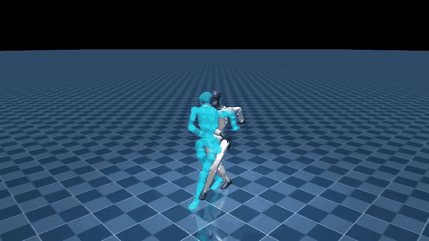

# supermimic-retargeted

Personal, AI-assisted robot adaptation of **SuperMimic-Reproduced** for **G1, A3 and X2 Ultra**.

这是一个个人、非官方的本体适配项目，主要通过 vibe coding 接入 A3、X2 Ultra，并整理数据准备、训练、评测和可视化流程。主要训练实现来自 [CuboiLeo/SuperMimic-Reproduced](https://github.com/CuboiLeo/SuperMimic-Reproduced)，交叉参考 [zita-ch/supermimic_vibed](https://github.com/zita-ch/supermimic_vibed)。我们没有提出新的算法；请优先引用原论文与上游项目。完整来源和固定版本见 [UPSTREAM.md](UPSTREAM.md)。

## Demo

[](media/demo.mp4)

[20 秒 MP4](media/demo.mp4) · [录制与剪辑信息](media/README.md)

同一段 LAFAN1 `dance1_subject1`，在 G1、X2 Ultra、A3 之间连续切换。实体是策略在物理仿真中的执行，青色半透明虚影是参考动作。三者使用相同相机距离，按模型实际尺寸显示；演示是选取的片段，完整结果见下方实验记录。

## 支持范围

| 本体 | 关节数 | 已记录的训练数据 |
|---|---:|---|
| Unitree G1 | 29 | LAFAN1、BONES 子集 |
| X2 Ultra | 31 | LAFAN1、约两千条 BONES 动作 |
| A3 | 31 | LAFAN1、约一万条 BONES 动作 |

适配工作包括本体参数与状态维度、可微 FK、SOMA 重定向、LAFAN 骨骼坐标及骨盆支点修正、脚底接触质检和参考虚影渲染。核心训练沿用世界模型与 BPTT Actor–Critic。

## 快速开始

需要 Linux、Python 3.12、uv、Git LFS 和 NVIDIA GPU；渲染视频另需 FFmpeg，也可使用已安装的 imageio-ffmpeg。主环境与 SOMA 重定向环境分别安装。本次训练服务器验证的主环境为 PyTorch `2.14.1+cu130`、MuJoCo `3.16.0`、Warp `1.18.0`；安装锁文件对应 CUDA 13，需要兼容的 NVIDIA 驱动。

```bash
git clone https://github.com/tianshuwu/supermimic-retargeted.git
cd supermimic-retargeted
uv sync --frozen --group dev

# 获取固定版本的外部源码与 A3/X2 资产
.venv/bin/python scripts/setup/fetch_upstreams.py
uv sync --project vendor/soma-retargeter --frozen
git -C vendor/soma-retargeter lfs pull --include='soma_retargeter/assets/robotics/agibot/**' --exclude=''
bash scripts/run_local.sh scripts/setup/build_robot_assets.py
```

仅使用 G1 时，可在安装主环境后直接运行 `bash scripts/run_local.sh scripts/setup/build_robot_assets.py --robot g1`。机器人 XML、网格和生成记录保存在 `assets/robots/`；外部来源与数据处理细节见 [数据文档](docs/DATA.md)。

后续命令使用 `scripts/run_local.sh` 调用本仓库的 `.venv/`。

## 数据与权重

**克隆代码后，需要自行下载并处理动作数据；训练权重目前不随仓库发布。**

- **LAFAN1**：G1 可使用已有重定向 CSV；A3/X2 从原始 BVH 做坐标适配与重定向。处理后统一放在 `data/npz/<robot>/lafan1/`。
- **BONES-SEED**：提供动作选择、重定向、过滤与打包流程，以及可选的 GitCode 镜像下载脚本。G1 与 SOMA 两个压缩包合计约 69 GB，解压和处理还需要额外空间。
- **`manifests/`**：只包含动作名称和选择清单，不包含可训练的轨迹数组。

下载来源、命令和过滤要求见 [docs/DATA.md](docs/DATA.md)。训练产物默认保存到 `logs/<run-name>/`；`docs/results/` 是公开的历史评测记录，不是权重目录。

## 训练、评测与录像

准备好数据后，先查看配置或运行有界短训：

```bash
bash scripts/run_local.sh scripts/training/train.py --robot g1 --print-config
bash scripts/run_local.sh scripts/training/train.py --robot g1 --preset smoke
```

`smoke` 最多运行 100 个环境步，用于检查流程，不代表策略收敛。正式训练示例：

```bash
# 将 a3 替换为 g1 或 x2_ultra 选择其他本体
bash scripts/run_local.sh scripts/training/train.py --robot a3 \
  --run-name a3_lafan --env.num-envs 4096 --env.replay-capacity 512 \
  --env.anchor-obs --policy-trainer.batch-size 2048 --schedule.max-hours 3

# 检查点路径请替换成自己的训练产物
bash scripts/run_local.sh scripts/robot.py a3 scripts/evaluation/eval_benchmark.py \
  --ckpt logs/a3_lafan/ckpt_latest.pt

bash scripts/run_local.sh scripts/evaluation/render_policy.py --robot a3 \
  --ckpt logs/a3_lafan/ckpt_latest.pt --clip dance1_subject1 \
  --record-start-seconds 75 --seconds 20 --no-label --out videos/a3_clap.mp4
```

录像会先连续执行到开始时间，遇到终止条件即停止。多卡训练、恢复检查点、smoke 参数和命令细节见 [docs/USAGE.md](docs/USAGE.md)，BONES 扩容见 [docs/DATA.md](docs/DATA.md)。

## 历史实验记录

以下数字对应归档的训练配置和检查点；使用了额外的 `anchor_obs`，不与论文原始观测口径等价。

| 本体 | LAFAN 基线失败 / 40 | BONES 训练条数 | 扩容后 LAFAN 失败 / 40 | BONES 验证失败 / 198 |
|---|---:|---:|---:|---:|
| G1 | 0 | 1965 | 2 | 1 |
| X2 Ultra | 2 | 1976 | 2 | 0 |
| A3 | 0 | 9951 | 2 | 1 |

每个 BONES 训练库还包含 40 条 LAFAN。LAFAN 指标反映训练动作上的跟踪；BONES 验证按采集组隔离，但参与选模，不是未触碰的最终测试集。逐片段指标、检查点 SHA256 和实验配置说明见 [docs/results/](docs/results/README.md) 与 [docs/EXPERIMENTS.md](docs/EXPERIMENTS.md)。

## 使用范围

- 当前记录来自物理仿真，没有完成实机验证，也没有做与 SONIC 的公平比较。
- `anchor_obs` 给 Actor 额外提供参考与机器人锚点的相对位置和姿态。当前仿真从真值计算这些信息，实机需要对应的状态估计，不能把现有权重视为只靠编码器和 IMU 就可直接部署的策略。
- A3/X2 使用串联关节和刚性脚底模型，保留地面接触、关闭自碰撞。数据质检和短视频不能替代完整评测，当前仍有失败动作。

## 文档与测试

| 文档 | 内容 |
|---|---|
| [架构](docs/ARCHITECTURE.md) | 代码结构、训练流程与目录职责 |
| [数据准备](docs/DATA.md) | 下载、重定向、转换、过滤与打包 |
| [训练与评测](docs/USAGE.md) | 配置、smoke、多卡训练、恢复和录像 |
| [实验记录](docs/EXPERIMENTS.md) | 历史配置、指标口径与限制 |
| [脚本索引](scripts/README.md) | 当前命令入口 |
| [测试说明](tests/README.md) | CPU/GPU 测试及运行前提 |

```bash
bash scripts/run_local.sh -m pytest tests -m "not gpu and not dataset and not slow" -q
```

代码保留上游 MIT 许可，见 [LICENSE](LICENSE)。第三方工具、机器人资产、动作数据和演示素材保留其来源条款，见 [UPSTREAM.md](UPSTREAM.md)。
